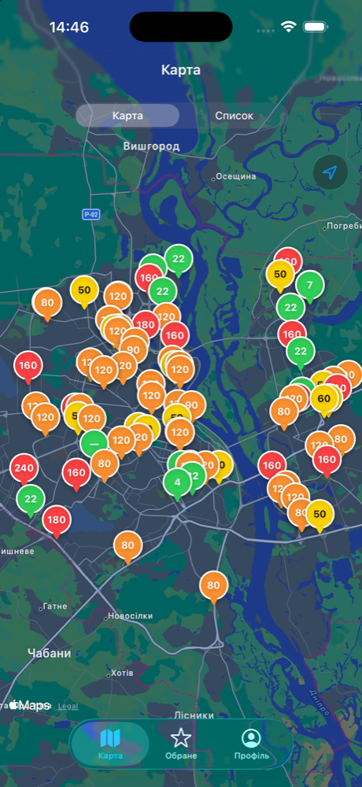
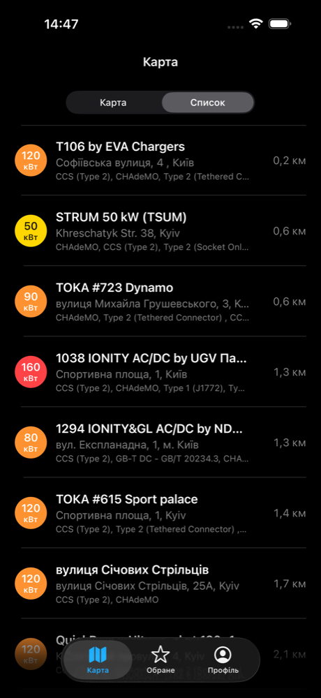
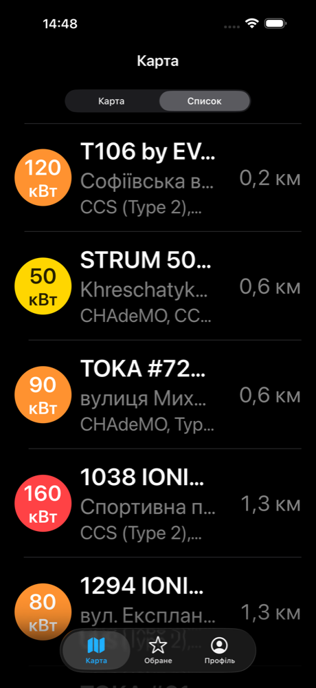
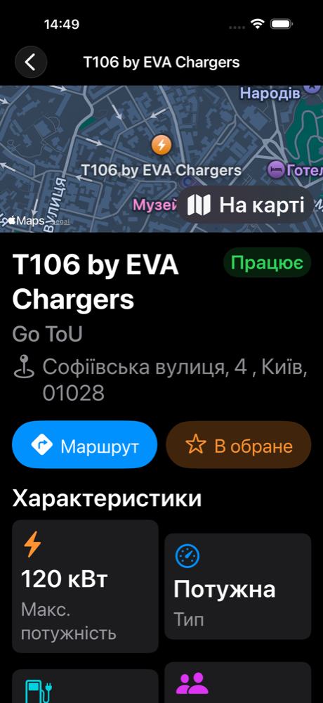

# Zaryad

Пошук зарядних станцій для електромобілів (iOS).

**Призначення:** знаходити зарядні станції поблизу, дивитись деталі та зберігати перевірені станції в обране з оцінкою.
**Користувач:** власник електромобіля.
**Джерело даних:** Open Charge Map API (станції) і Firebase — Auth (акаунти) та Firestore (обране).

## Навчальні дисципліни

Код один для обох дисциплін; різниться лише те, що здається.

### iOS-розробка — практичні роботи

| Робота | Тег | Що зроблено |
|---|---|---|
| №1 | `practical-1` | Базові моделі (`ChargingStation`, `FavoriteStation`), сценарій «Обране», Swift-конструкції (див. нижче) |
| №2 | `practical-2` | MVVM, патерни, SOLID — [docs/Architecture.md](docs/Architecture.md) |
| №3 | `practical-3` | Координатори, карта MapKit, деталі станції, навігація — [docs/Navigation.md](docs/Navigation.md) |
| №4 | `practical-4` | Мережевий шар, Open Charge Map, Firebase (Auth + Firestore по HTTP), профіль, геолокація — [docs/Run.md](docs/Run.md) |

### ЖЦРПЗ — лабораторні роботи

| Робота | Де |
|---|---|
| №1 Специфікація вимог | Окремий документ |
| Архітектура ПЗ (Clean-lite, MVVM + Coordinator, UML) | Окремий документ |
| №4 Базова структура коду | Цей репозиторій: структура проєкту, ролі та запуск — нижче |
| №5 Інтеграція компонентів і залежності | Розділ [«ЖЦРПЗ — Лабораторна №5»](#жцрпз--лабораторна-5) |
| №6 Тестування та валідація | Розділ [«ЖЦРПЗ — Лабораторна №6»](#жцрпз--лабораторна-6) |

## Структура проєкту

```
Zaryad/
├── App/            — точка входу, AppCoordinator, TabBarCoordinator, конфіг Firebase
├── NavigationKit/  — базовий Coordinator, HostingController
├── Core/           — інфраструктура
│   ├── Network/    — Endpoint (builder), RequestManager, RawResponse, NetworkError
│   ├── Location/   — LocationService (CoreLocation)
│   ├── Observing/  — ObserverList (підписки з weak owner)
│   └── UI/Toast/   — тост помилок
├── Domain/         — сутності та протоколи репозиторіїв (без залежностей від фреймворків)
├── Data/           — реалізації репозиторіїв
│   ├── DTO/        — OCMStationDTO, FavoriteStationDTO
│   ├── Endpoint/   — OCMEndpoint, FirestoreEndpoint
│   ├── Mappers/    — StationMapper (DTO ↔ домен)
│   ├── Firebase/   — FirebaseService (Auth SDK), FirestoreCoder
│   └── Repository/ — StationsRepository, FirebaseAuthRepository, FirebaseFavoritesRepository
├── Feature/        — фічі: Coordinator + Assembly + Screens (View / VM / Models / Mappers)
│   ├── MapFeature/
│   ├── StationDetailsFeature/
│   ├── FavoritesStationFeature/
│   └── ProfileFeature/
└── UIResources/    — асети, LaunchScreen
ZaryadTests/        — unit- і компонентні тести (Swift Testing)
tests/maestro/      — системні UI-тести (Maestro)
docs/               — архітектура, навігація, запуск, скриншоти
firestore.rules     — правила безпеки Firestore
```

Залежності спрямовані до `Domain`: фічі працюють з протоколами репозиторіїв, конкретні реалізації (`Data`) передаються через координатори й Assembly.

## Ролі

Проєкт виконує одна людина — **Ілля Верезей**, full-stack: вимоги й архітектура, iOS-клієнт (UI, навігація, бізнес-логіка), інтеграція з Open Charge Map та Firebase, налаштування Firestore Rules, тестування на симуляторі.

Робота в Git: кожна лабораторна — окрема гілка `lab-N`, яка зливається в `dev`; підсумок позначається тегом `practical-N`.

## Запуск

Відкрити `Zaryad.xcodeproj` у Xcode, дочекатися завантаження пакета Firebase, запустити схему `Zaryad` на симуляторі (iOS 17+). Власний сервер не потрібен.

На карті надати доступ до локації — піде перший запит до Open Charge Map. Детально, з перевіркою станів: [docs/Run.md](docs/Run.md).

## ЖЦРПЗ — Лабораторна №5

Інтеграція компонентів і управління залежностями. Вимоги — зі специфікації (Лаб. №1).

### Метод інтеграції

Зовнішні сервіси, власного бекенду немає:

| Сервіс | Роль | Як інтегровано |
|---|---|---|
| Open Charge Map API | станції | REST (`OCMEndpoint` → `RequestManager`) |
| Firebase Authentication | акаунти | Firebase iOS SDK (`FirebaseService`) |
| Cloud Firestore (`zaryad-12303`, `europe-central2`) | обране | REST (`FirestoreEndpoint` → `RequestManager`), правила — `firestore.rules` |

Відхилення від стеку специфікації (Auth REST + Realtime Database): Auth через SDK — токен у Keychain (NFR-5); дані — Firestore REST, обмін залишився по HTTP.

### Залежності

| Залежність | Менеджер | Версія |
|---|---|---|
| firebase-ios-sdk (`FirebaseCore`, `FirebaseAuth`) | Swift Package Manager | `upToNextMajor` від 13.0.1, зафіксовано в `Package.resolved` |

`Package.resolved` у репозиторії (`Zaryad.xcodeproj/project.xcworkspace/xcshareddata/swiftpm/`) — однакові версії в усіх.

### Функціональні вимоги

| ID | Вимога | Статус | Де / як перевірити |
|---|---|---|---|
| FR-1 | Перелік станцій у радіусі | ✅ | Карта → «Список» (за відстанню) — `MapScreenView`, `MapVM` |
| FR-2 | Станції на карті (піни) | ✅ | Таб «Карта» — `MapScreenView` |
| FR-3 | Деталі станції | ✅ | Пін / рядок → «Детальніше» — `StationDetailsView` |
| FR-4 | Реєстрація (email + пароль) | ✅ | Профіль → «Створити акаунт» — `AuthVM`, `FirebaseAuthRepository` |
| FR-5 | Авторизація | ✅ | Профіль → «Увійти» |
| FR-6 | Додати в обране | ✅ | Деталі → «В обране» — `FirebaseFavoritesRepository` |
| FR-7 | Власна оцінка | ✅ | Попап оцінки 1–5 — `RatingPopup` |
| FR-8 | Перелік збережених | ✅ | Таб «Обране» — `FavoritesListView` |
| FR-9 | Видалити станцію з обраного | ✅ | Кошик у рядку / «В обраному» в деталях |
| FR-10 | Очистити все обране | ⏳ | Середній пріоритет — наступна ітерація (специфікація, розд. 7) |
| FR-11 | Фільтр за роз'ємом і потужністю | ⏳ | Середній пріоритет — наступна ітерація (специфікація, розд. 7) |
| FR-12 | Повторний пошук у видимій зоні | ✅ | Автопошук після зупинки камери + «Повторити» при помилці — `MapScreenView` |
| FR-13 | Маршрут у застосунку карт | ✅ | Деталі → «Маршрут» (Apple Maps) — `StationDetailsVM.openRoute` |
| FR-14 | Поточне місцезнаходження | ✅ | Запит доступу на старті, карта центрується — `LocationService` |
| FR-15 | Вихід з акаунта | ✅ | Профіль → «Вийти» |
| FR-16 | Обмеження для ролі «Гість» | ✅ | Гість → «В обране» → перехід у Профіль — `PProfileProvider` |

### Нефункціональні вимоги

| ID | Вимога | Статус | Як забезпечено |
|---|---|---|---|
| NFR-1 | Пошук ≤ 2 с | ✅ | Один запит після зупинки камери, попередній скасовується; `maxresults=100` |
| NFR-2 | Кешування в пам'яті | ⏳ | Наступна ітерація |
| NFR-3 | Типи помилок, повтор | ✅ | `NetworkError` (transport / http / decoding), тост + «Повторити» |
| NFR-4 | Порожні стани | ✅ | «Поруч немає станцій», «Немає обраного» |
| NFR-5 | Безпека даних | ✅ | `firestore.rules`: доступ лише до власних `users/{uid}`; токен у Keychain (Firebase Auth SDK) |
| NFR-6 | Адаптивність, темна тема | ✅ частково | Темна тема і великий шрифт — скриншоти нижче (iPhone 17 Pro Max); малий екран окремо не перевірявся |
| NFR-7 | iOS 17.0+ | ✅ | `IPHONEOS_DEPLOYMENT_TARGET = 17.0` |
| NFR-8 | Квота зовнішнього API | ✅ частково | Радіус 1–50 км, `maxresults=100`, скасування зайвих запитів; кешу немає (NFR-2) |
| NFR-9 | Стандартні компоненти, Dynamic Type | ✅ | SwiftUI / UIKit, `@ScaledMetric` для бейджів |

### Тестування

**Компоненти окремо** — unit-тести (Swift Testing), таргет `ZaryadTests`, 12 тестів:

| Сюїта | Що перевіряє |
|---|---|
| `MapVMTests` | старт з локації / fallback Київ (FR-14), список за відстанню (FR-1), empty (NFR-4), error і повтор (NFR-3), пошук у зоні (FR-12), відкриття деталей (FR-3) |
| `FirestoreCoderTests` | кодування в типи Firestore, round-trip документа, порожня колекція |

Запуск: Xcode → `Cmd+U`, або

```bash
xcodebuild test -project Zaryad.xcodeproj -scheme Zaryad -destination 'platform=iOS Simulator,name=iPhone 17 Pro Max' -only-testing:ZaryadTests
```

**Цілісність** — сценарій на симуляторі:

1. Старт → дозвіл геолокації → піни навколо користувача (OCM).
2. «Список» → тап по станції → деталі.
3. Гість → «В обране» → перехід у Профіль → реєстрація (Firebase Auth).
4. Деталі → «В обране» → оцінка → станція в табі «Обране» (Firestore).
5. Вихід → «Обране» порожнє; повторний вхід → обране повертається.

### Скриншоти (iPhone 17 Pro Max, iOS 26.5)

| Карта, темна тема | Список, темна тема | Список, великий шрифт | Деталі, великий шрифт |
|---|---|---|---|
|  |  |  |  |

## ЖЦРПЗ — Лабораторна №6

Тестування та валідація. Вимоги — зі специфікації (Лаб. №1), статуси реалізації — [Лаб. №5](#жцрпз--лабораторна-5).

### Інструменти

| Рівень | Інструмент | Де |
|---|---|---|
| Юніт | Swift Testing | `ZaryadTests/*Tests.swift` |
| Компонентний | Swift Testing + `URLProtocol`-стаб замість мережі | `ZaryadTests/Component/` |
| Системний | Maestro (UI-флоу на симуляторі) | `tests/maestro/` |
| Покриття | `xcodebuild -enableCodeCoverage YES` + `xccov` | — |

### Юніт-тестування — 29 тестів, ✅ 29/29

| Сюїта | Тестів | Що перевіряє |
|---|---|---|
| `MapVMTests` | 8 | локація / fallback (FR-14), сортування за відстанню (FR-1), empty / error / повтор (NFR-3, NFR-4), пошук у зоні (FR-12), деталі (FR-3) |
| `StationMapperTests` | 5 | DTO OCM → домен: відкидання записів без ID, порядок, округлення потужності, дата з мілісекундами і без, round-trip домен ↔ DTO (обране) |
| `MapStationUIMapperTests` | 3 | станції без координат відкидаються, категорія потужності за макс. роз'ємом (параметризовано), відстань від центру пошуку |
| `ProfileUIMapperTests` | 4 | ініціали з імені, ім'я з email, відмінювання «станція / станції / станцій» (параметризовано), тире до завантаження |
| `AuthVMTests` | 5 | вхід і реєстрація (FR-4, FR-5), неактивна кнопка при порожніх полях, тексти помилок Firebase (параметризовано), скидання помилки при зміні режиму |
| `FirestoreCoderTests` | 4 | типи Firestore, round-trip документа |

### Компонентне тестування — 10 тестів, ✅ 10/10

Справжній ланцюжок `Repository → Endpoint → RequestManager → URLSession`; мережа замінена `StubURLProtocol`, тож тести детерміновані й не витрачають квоту API.

| Сюїта | Сценарій | Очікування |
|---|---|---|
| Open Charge Map | 200 + JSON | станції змаплено; `GET /v3/poi`, `latitude`, `longitude`, `distance`, `distanceunit=km`, `maxresults=100`, `output=json`, заголовок `X-API-Key` |
| | 200 + `[]` | порожній результат (NFR-4) |
| | 403 | `NetworkError.http(403)` + тост «Немає доступу» (NFR-3) |
| | немає мережі | `NetworkError.transport` + тост «Немає з'єднання з інтернетом» |
| | битий JSON | `NetworkError.decoding` |
| Firestore (обране) | завантаження | `GET users/{uid}/favorites`, `Authorization: Bearer …`, документи → обране (FR-8) |
| | гість | жодного запиту (FR-16) |
| | додавання | `PATCH users/{uid}/favorites/{id}` з полями Firestore (FR-6, FR-7) |
| | видалення | `DELETE users/{uid}/favorites/{id}` (FR-9) |
| | 403 від правил | помилка, а не тихий успіх (NFR-5) |

**Перевірка, що тести ловлять регресії (red-probe):** тимчасово `maxresults=50` і інший текст тосту для 403 → 2 тести червоні; код відновлено → зелені.

### Системне тестування — Maestro

| Флоу | Вимоги | Результат |
|---|---|---|
| `01_map_list_toggle` | FR-1, регресія бага №1 | ✅ |
| `02_station_details` | FR-2, FR-3, «На карті», регресія бага №2 | ✅ (до виправлення — ❌) |
| `03_guest_profile` | FR-16, FR-4, NFR-3 | ✅ |
| `04_sign_in_favorite` | FR-5, FR-6…FR-9 | запускається з власним тестовим акаунтом (`-e EMAIL -e PASSWORD`) |

Запуск — [tests/maestro/README.md](tests/maestro/README.md).

### Покриття

`xccov`, iPhone 17 Pro Max, iOS 26.5:

| Область | Покриття |
|---|---|
| Увесь застосунок (`Zaryad.app`, разом із View) | 30.4 % (1343 / 4413 рядків) |
| Логіка без View / координаторів / Assembly | 60.3 % (863 / 1432) |
| `RequestManager`, `RawResponse`, `StationsRepository`, `AuthVM`, `ProfileUIMapper`, `ObserverList` | 98–100 % |
| `StationMapper`, `MapStationUIMapper`, `OCMEndpoint`, `FirestoreEndpoint`, `NetworkError` | 87–95 % |
| `FirestoreCoder`, `FirebaseFavoritesRepository`, `MapVM` | 77–89 % |
| `StationDetailsVM`, `StationDetailsUIMapper`, `FavoriteStationUIMapper` | 0 % — не покрито |

View перевіряються системними тестами (Maestro), у відсоток `xccov` вони не потрапляють.

### Знайдені помилки

| № | Помилка | Вплив | Як усунуто |
|---|---|---|---|
| 1 | Перемикач «Карта / Список» у `ToolbarItem(.principal)` на iOS 26 не реагував на тапи | FR-1 недоступна | Перенесено в `safeAreaInset(edge: .top)` (коміт `a08321c`); регресія — флоу `01` |
| 2 | Деталі → «На карті» при активному режимі «Список» лишали список: станцію не видно | FR-3 / перехід на карту не працює | `MapScreenView`: при виборі станції режим перемикається на «Карта»; регресія — флоу `02` |
| 3 | Бейдж потужності в списку обрізався при великому шрифті | NFR-9 | `@ScaledMetric` + `minimumScaleFactor` |
| 4 | У режимі «Список» сегменти перемикача не потрапляють у дерево доступності XCUITest | автотест тапає за координатою; можливий вплив на VoiceOver | Не усунуто — див. рекомендації |

### Валідація

**Функціональні:** 14 / 16 виконано й перевірено (unit, компонентні або Maestro). FR-10 (очистити все обране) і FR-11 (фільтр за роз'ємом і потужністю) не реалізовано.

**Нефункціональні:**

| ID | Вимога | Результат | Доказ |
|---|---|---|---|
| NFR-1 | Пошук ≤ 2 с | ✅ середнє 0.61 с, макс. 0.80 с | 5 запитів до OCM (10 км, 100 станцій, 287 КБ): 0.80 / 0.60 / 0.40 / 0.46 / 0.78 с; лише мережа, рендер не вимірювався |
| NFR-2 | Кешування | ❌ | Не реалізовано |
| NFR-3 | Помилки, повтор | ✅ | Компонентні тести 403 / offline / decoding, `MapVMTests` |
| NFR-4 | Порожні стани | ✅ | `MapVMTests`, компонентний тест `[]` |
| NFR-5 | Безпека | ✅ | Bearer-токен у кожному запиті, правила Firestore (403 → помилка) |
| NFR-6 | Адаптивність | ✅ частково | Скриншоти Лаб. №5; малий екран не перевірявся |
| NFR-7 | iOS 17+ | ✅ | `IPHONEOS_DEPLOYMENT_TARGET = 17.0` |
| NFR-8 | Квота API | ✅ частково | `maxresults=100` перевірено компонентним тестом; кешу немає |
| NFR-9 | Dynamic Type | ✅ | Баг №3 виправлено |

### Рекомендації

1. **NFR-2 / NFR-8:** кеш результатів OCM у пам'яті за ключем «центр + радіус», щоб менше запитів при поверненні до тієї ж зони.
2. **FR-10, FR-11:** «Очистити все» (пакетне видалення в Firestore) і фільтр роз'єм / потужність у `MapVM`.
3. **Покриття:** тести для `StationDetailsVM` і `FavoriteListVM` — зараз найменш покриті VM.
4. **Доступність:** `accessibilityIdentifier` для перемикача й перевірка з VoiceOver (баг №4).
5. **CI:** GitHub Actions — `xcodebuild test` і guest-флоу Maestro на кожен push у `dev`.
6. **NFR-1:** вимірювати повний час «запит → піни на екрані» через `os_signpost`.

## Основні сценарії
- Пошук станцій на карті навколо користувача, картка та деталі станції, маршрут в Apple Maps.
- Акаунт (реєстрація / вхід Email + пароль).
- Додавання станції в обране з оцінкою (Карта → станція → «Детальніше» → «В обране»), видалення, перегляд у табі «Обране». Обране прив'язане до акаунта.

## Сутності

### `ChargingStation` — доменна модель станції
Дзеркалить POI-схему Open Charge Map. Ключові поля: `id: Int`, `addressInfo` (назва, адреса, координати, країна), `operatorInfo`, `statusType` (операційна/ні), `usageType`, `connections` (роз'єми: тип, потужність кВт, AC/DC, кількість), `numberOfPoints`, `dateLastVerified`.
📄 `Zaryad/Domain/Models/ChargingStation.swift`

### `FavoriteStation` — обрана станція
Відрізняється тим, що користувач додає **оцінку** та нотатку.
```
station: ChargingStation, rate: Int, note: String?
```
📄 `Zaryad/Domain/Models/FavoriteStation.swift`

### `FavoriteStationUIModel` — модель для UI
Готові для показу поля + власна ідентичність.
```
id: UUID          // унікальний id для List/ForEach
stationId: Int    // id станції з домену
name, address, power: PowerTier, powerKW: Int?, connectorsText, rate, note, needToDelete
```
📄 `.../FavoritesList/Models/FavoriteStationUIModel.swift` (+ `enum PowerTier` — градація потужності)

## Де в коді реалізовано Swift-конструкції

| Конструкція | Де |
|---|---|
| `struct` | `ChargingStation`, `FavoriteStation`, `FavoriteStationUIModel`, `FavoriteStationUIMapper` |
| `class` | `FavoriteListVM`, `FirebaseFavoritesRepository`, `RequestManager` |
| `protocol` | `PFavoritesRepository`, `PFavoriteListVM` |
| `enum` | `PowerTier`, `FavoriteListViewState`, `FavoritesStationEvent` |
| `var` / `let`, властивості, методи, `init` | `FavoriteListVM` (`@Published var state`, `let repo`, `init(repo:)`, `remove`, `loadStations`) |
| колекція + обробка (`map`/`filter`/`compactMap`/`forEach`) | `FavoriteStationUIMapper`, `FavoriteListVM` |
| словник (колекція) | `domainStationsById: [Int: FavoriteStation]` у `FavoriteListVM` |
| optional + безпечне розгортання (`guard let`, `?.`, `compactMap`) | `FavoriteStationUIMapper`, `FavoriteListVM` |
| умовна конструкція (`switch`/`guard`) | `FavoritesListView` (стани екрана), `FavoriteListVM` |

## Стек
Swift · UIKit + SwiftUI (UIHostingController) · MapKit · CoreLocation · MVVM + Coordinator · URLSession · Open Charge Map · Firebase Auth + Firestore (REST).
