# Навігація — Zaryad

Документ описує навігацію застосунку: дерево координаторів, переходи між екранами та їх демонстрацію на симуляторі (iPhone 17 Pro).

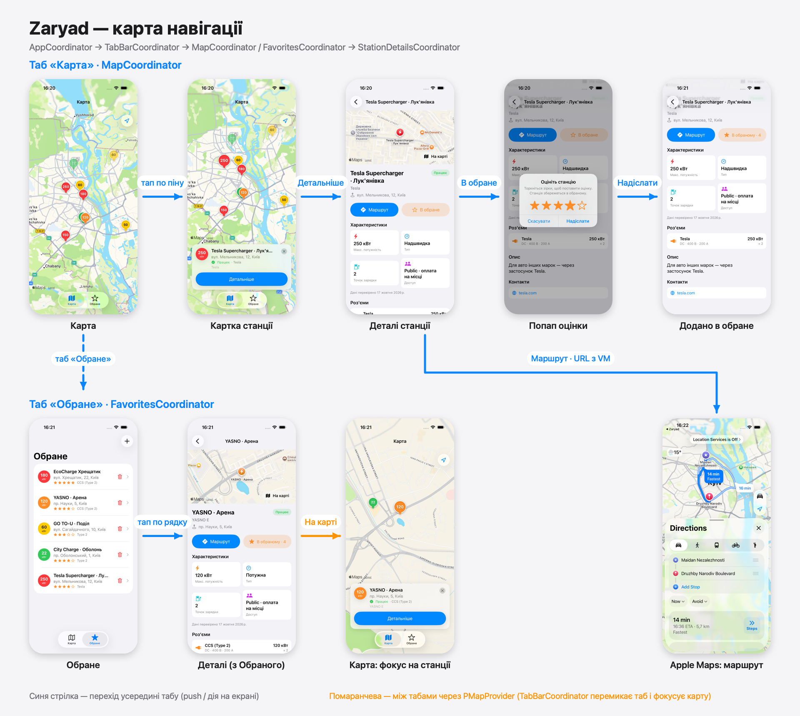

🎬 **Відео-демонстрація:** [navigation/navigation-demo.mp4](navigation/navigation-demo.mp4) (~2 хв, весь сценарій нижче одним проходом).

## Дерево координаторів

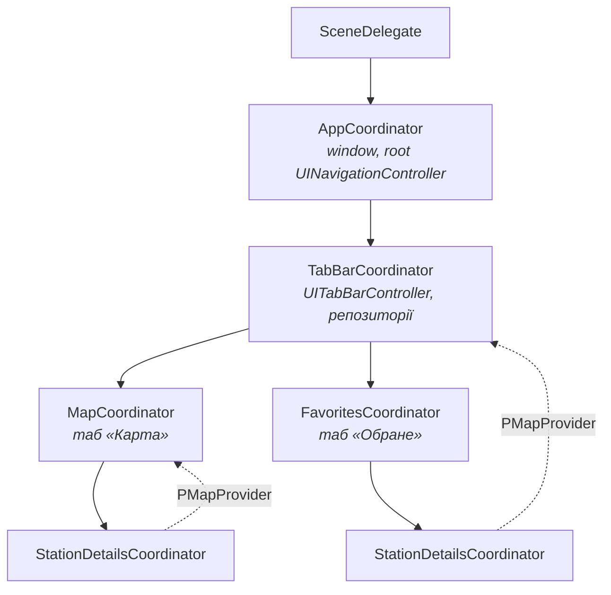

- **AppCoordinator** — сетить `rootViewController` вікна й запускає головний флоу.
- **TabBarCoordinator** — створює таби, тримає репозиторії (`PStationsRepository`, `PFavoritesRepository`) і передає їх дочірнім координаторам; реалізує `PMapProvider` для переходу на карту з інших табів.
- **MapCoordinator / FavoritesCoordinator** — рутові координатори табів, кожен зі своїм `UINavigationController`.
- **StationDetailsCoordinator** — екран деталей; один і той самий для обох табів. Отримує `PMapProvider` і через нього обробляє «На карті». Звільняється (`free()`), коли екран прибирають зі стеку (`HostingController.onRemoveFromParent`).

## Переходи

| # | Звідки | Дія | Куди | Хто керує |
|---|---|---|---|---|
| 1 | Карта | тап по піну | Картка станції (на тому ж екрані) | `MapVM.selectStation` |
| 2 | Картка станції | «Детальніше» | Деталі станції (push) | `MapCoordinator` → `StationDetailsCoordinator` |
| 3 | Деталі станції | «В обране» | Попап оцінки (зірки в рядок) | `StationDetailsVM` → `RatingPopup` |
| 4 | Попап оцінки | «Надіслати» | Деталі: «В обраному · N» | `StationDetailsVM.addToFavorites` |
| 5 | Деталі станції | «Маршрут» | Apple Maps з маршрутом | `StationDetailsVM.openRoute` (URL) |
| 6 | Будь-який екран | таб «Обране» | Список обраного | `UITabBarController` |
| 7 | Обране | тап по рядку | Деталі станції (push у табі «Обране») | `FavoritesCoordinator` → `StationDetailsCoordinator` |
| 8 | Деталі (з Обраного) | «На карті» | Таб «Карта», камера на станції, картка відкрита | `PMapProvider` = `TabBarCoordinator` → `MapCoordinator` |
| 9 | Деталі (з Карти) | «На карті» | Повернення до карти з фокусом на станції | `PMapProvider` = `MapCoordinator` |
| 10 | Деталі | «‹» назад | Попередній екран | `UINavigationController`, координатор деталей звільняється |

## Демонстрація на симуляторі

Сценарій: знайти станцію на карті → відкрити деталі → додати в обране з оцінкою → перевірити в табі «Обране» → з деталей іншої станції перейти на карту → побудувати маршрут.

| | | |
|:---:|:---:|:---:|
| 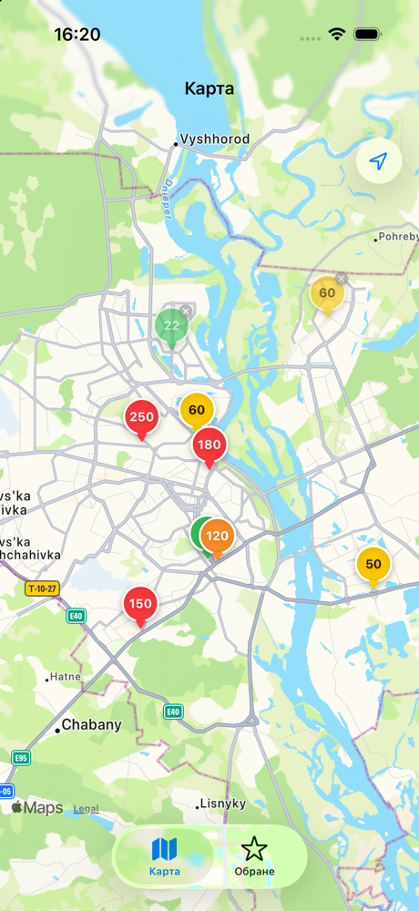 | 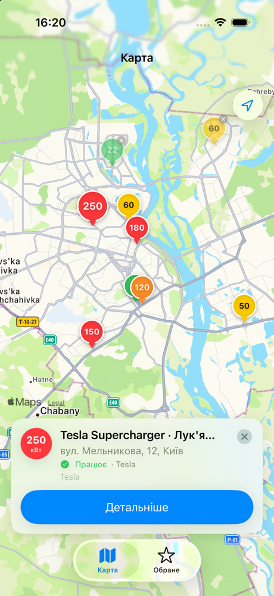 | 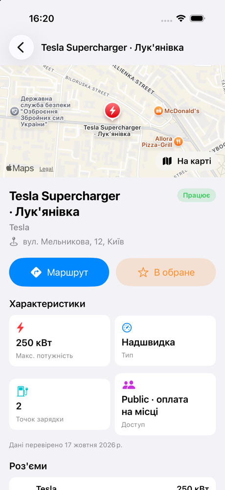 |
| **1. Карта** — піни станцій, колір за потужністю, ✕ — недоступна | **2. Картка станції** — після тапу по піну | **3. Деталі станції** — характеристики, маршрут, обране |
| 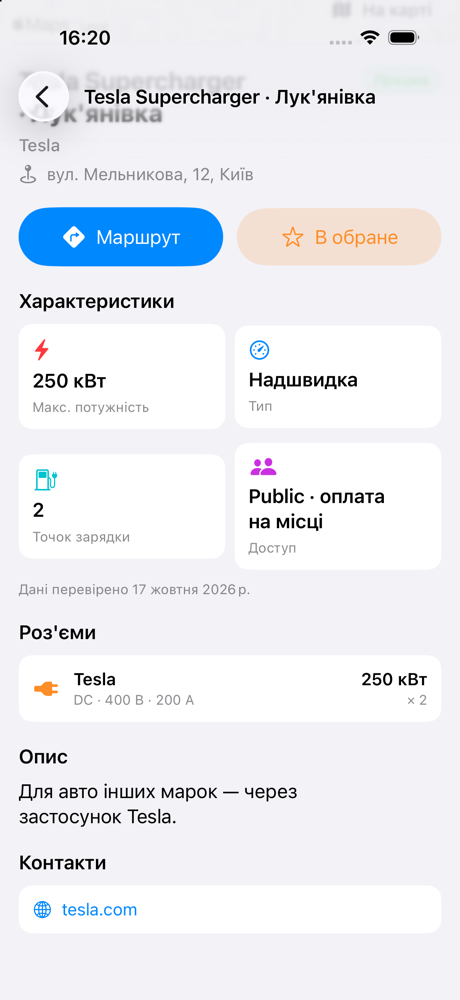 | 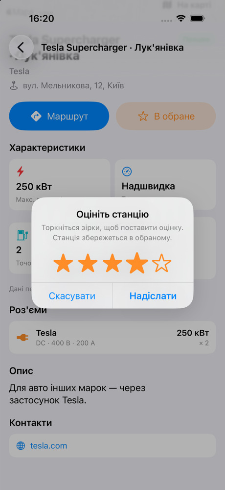 | 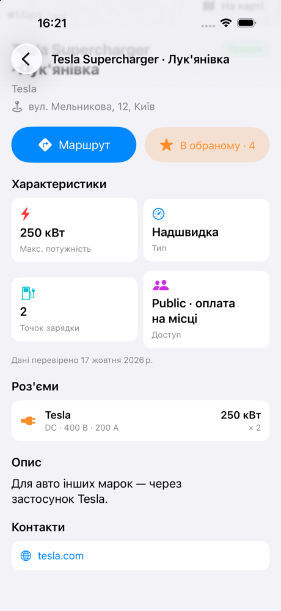 |
| **4. Деталі (низ)** — роз'єми, опис, контакти | **5. Попап оцінки** — тап або свайп по зірках | **6. Додано в обране** — кнопка показує оцінку |
| 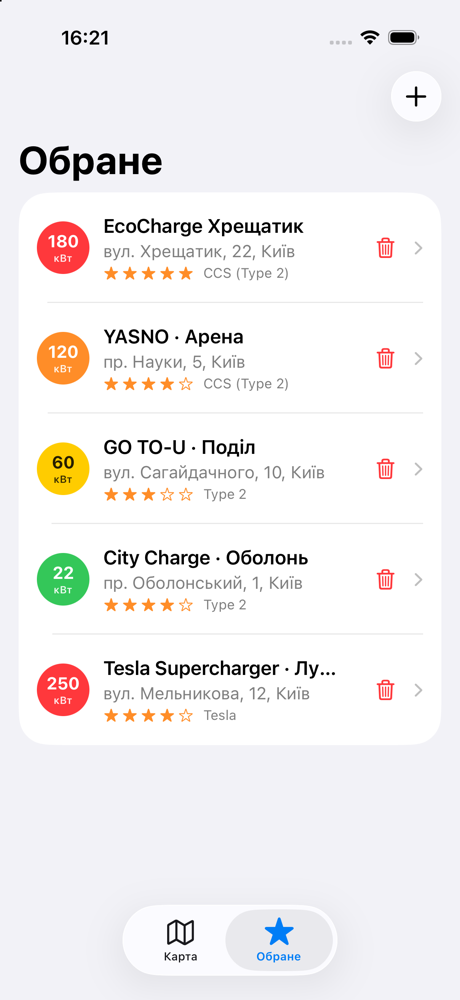 | 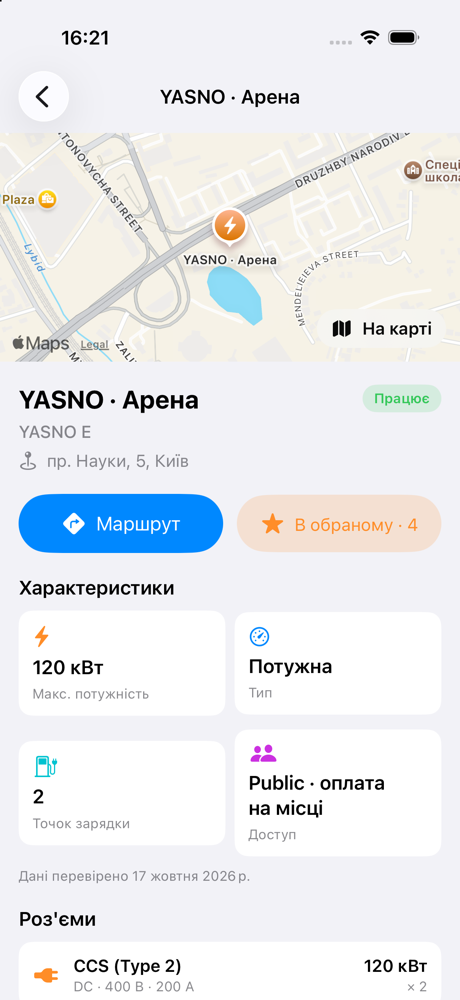 | 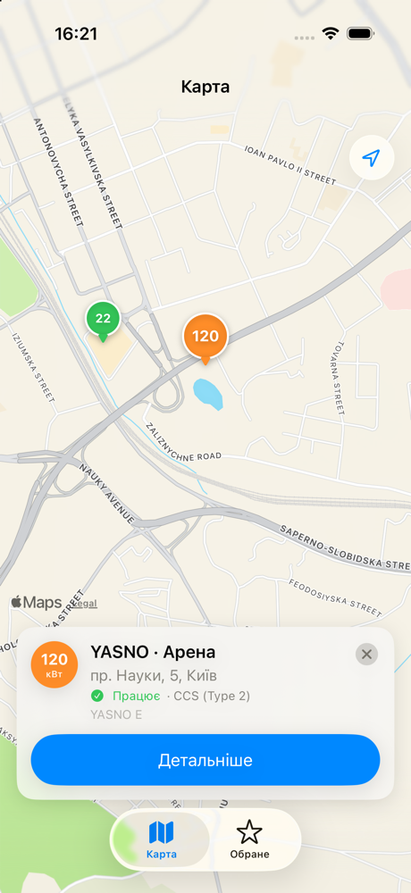 |
| **7. Обране** — нова станція вже в списку (спільний репозиторій) | **8. Деталі з табу «Обране»** — кнопка «На карті» на шапці | **9. Карта** — після «На карті»: перемкнуто таб, фокус і картка станції |
| 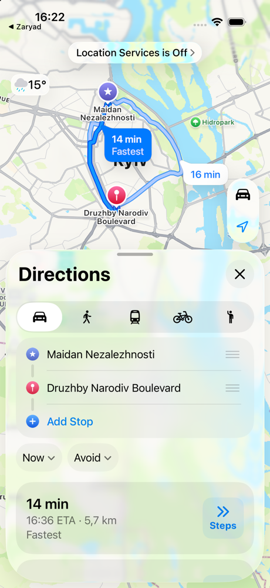 | | |
| **10. Apple Maps** — маршрут до станції | | |

> Скриншоти та відео записані на iPhone 17 Pro (iOS 26.5) з мок-даними (`MockStationsRepository`, `MockFavoritesRepository`). На кроці 10 геолокація в симуляторі вимкнена, тому точку старту в Apple Maps вибрано вручну.
